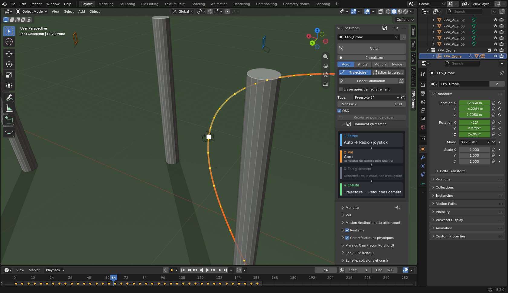
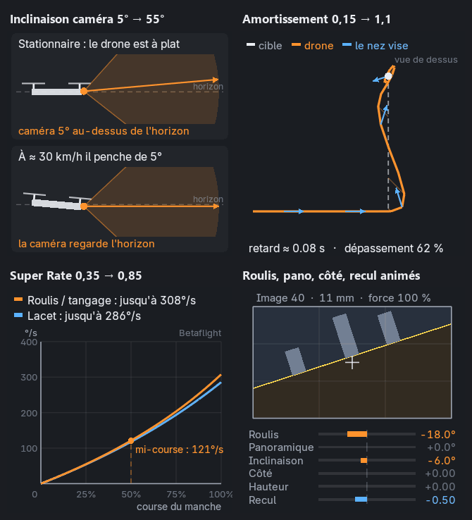
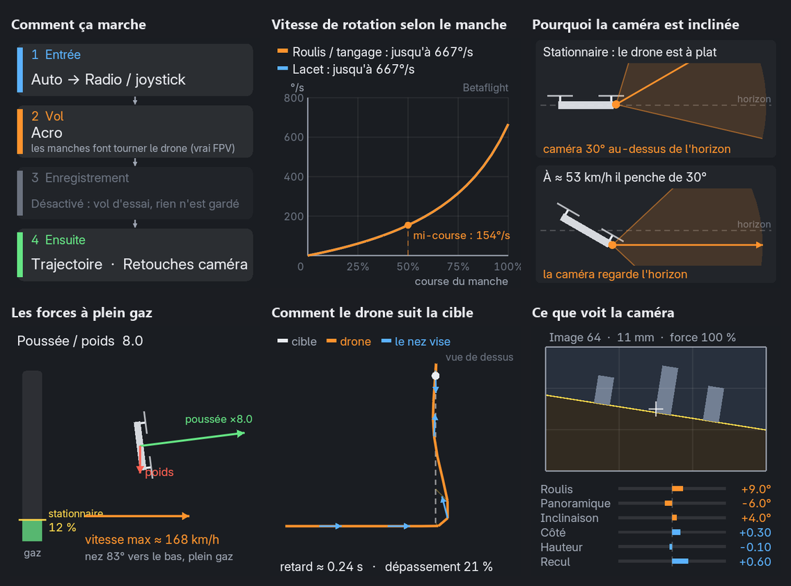
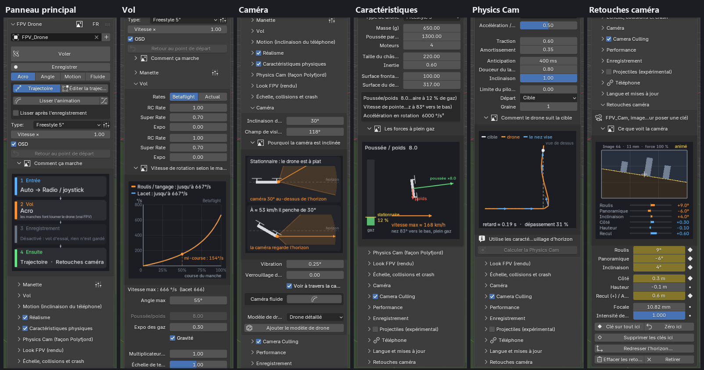
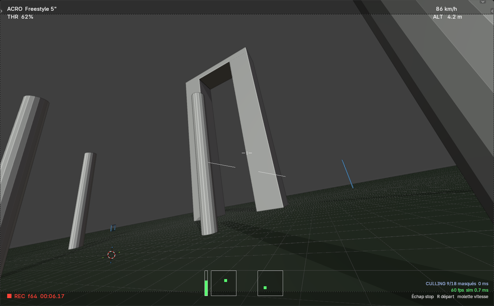
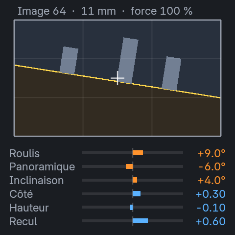
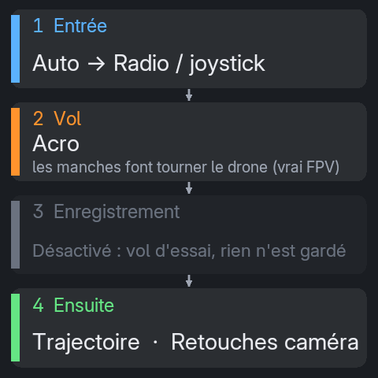
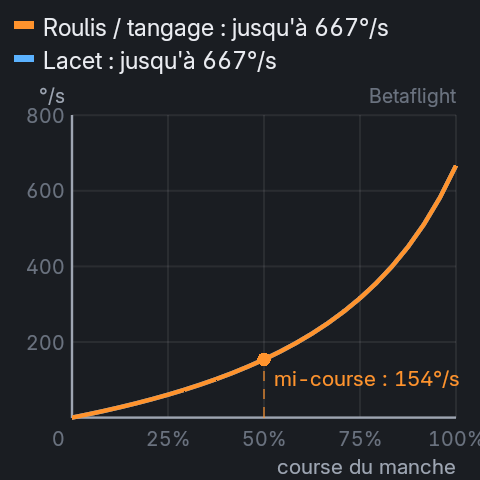
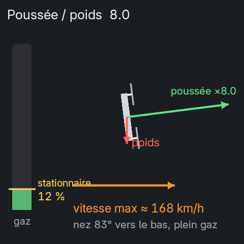
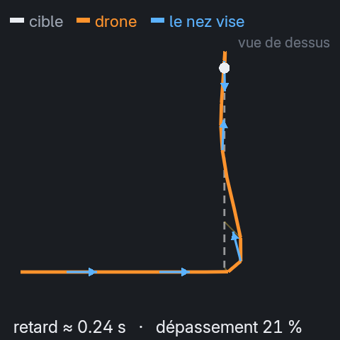

# FPV Drone 2.16.0 – extension Blender 4.2 → 5.x (testée 5.3)

Pilote une caméra comme un drone FPV (radiocommande, manette ou clavier) et enregistre le vol en keyframes.
Réécriture complète de *Quadcopter FPV Simulator* (WizardOfRobots, 2021), sous licence GPL-3.0-or-later.

Testée sur Blender **5.0.1, 5.1.2 et 5.3.0**. QR code : bibliothèque *QR Code generator* de Project Nayuki (MIT), incluse.

## Installation
Glisse `fpv_drone-2.15.0.zip` dans la fenêtre de Blender, ou *Edit › Preferences › Get Extensions › ⌄ › Install from Disk*.
Le panneau apparaît dans la Vue 3D › barre latérale (N) › onglet **FPV Drone**.

Aucune installation pip ni pygame n'est nécessaire sous Windows.

## En images

### Les schémas dynamiques (2.14)
Les panneaux expliquent eux-mêmes leurs réglages avec un schéma **en direct** : il se redessine dès que tu bouges une valeur.

| Schéma | Panneau | Ce qu'il montre |
|---|---|---|
| **Comment ça marche** | FPV Drone | Les 4 étapes : entrée détectée → mode de vol → enregistrement → retouches. L'étape inactive est grisée (ex. *Enregistrer* désactivé = vol d'essai). |
| **Vitesse de rotation selon le manche** | Vol | La courbe des rates (Betaflight ou Actual) : roulis / tangage en orange, lacet en bleu, valeur à mi-course et au maximum. |
| **Pourquoi la caméra est inclinée** | Caméra | Le drone de profil en stationnaire puis en vol : à quelle vitesse la caméra regarde l'horizon avec ton inclinaison et ton champ de vision. |
| **Les forces à plein gaz** | Caractéristiques physiques | Poussée contre poids, gaz du vol stationnaire, inclinaison et vitesse max calculées depuis tes vraies valeurs. |
| **Comment le drone suit la cible** | Physics Cam | Vue de dessus d'un virage : la cible, le drone tiré par le ressort, où vise le nez, le retard et le dépassement. |
| **Ce que voit la caméra** | Retouches caméra | L'horizon et le cadre à l'image courante avec le roulis / pano / inclinaison, et des barres pour côté / hauteur / recul. |

Chaque schéma se replie (petit triangle) et l'icône 🖼 à côté de *FR / EN* en haut du panneau les masque tous (aussi dans *Préférences › Add-ons › FPV Drone*).

### Dans les panneaux

### En vol : l'OSD
Vue à travers la caméra FPV pendant un vol enregistré : mode et gaz, vitesse et altitude, sticks, enregistrement (REC), images par seconde et camera culling.

## Nouveautés 2.17
- **TAKUMI FPV ouvre directement le `.blend`** : le logiciel lance Blender en arrière-plan pour exporter la scène (cache dans `TAKUMI_FPV/` à côté du fichier, refait seulement si le `.blend` change). L'échelle (mètres par unité) réglée dans l'addon est reprise, même sans l'addon installé chez le pilote.
- **Alembic** : chaque prise peut aussi être écrite en `.abc` (caméra seule, une clé par image, même focale). Dans Blender : *Fichier › Importer › Alembic (.abc)*, ou *Importer une prise du logiciel* avec le `.json`. Les deux donnent exactement le même mouvement.
- Le script `appbridge.py` se lance aussi en ligne de commande (`export-scene`, `take-to-abc`).

## Nouveautés 2.16
- **Logiciel TAKUMI FPV** (pilote sans Blender) : *Exporter la scène pour le logiciel* écrit un `.glb` (objets, matériaux, animation de la scène ; textures réduites à 2048 px dans l'export seulement) et un `.json` (images, i/s, résolution, échelle, caméras de départ). Le pilote l'ouvre dans TAKUMI FPV, vole à la radio, et chaque prise est un `.json` (une position et une rotation par image, en coordonnées monde Blender). *Importer une prise du logiciel* en fait une caméra avec une clé par image.
- **Renvoyer la caméra du pilote** (panneau *Enregistrement*, en bas) : un pilote vole sur une copie de la scène, puis **Exporter la caméra** fige la caméra pilotée (une clé par image, en coordonnées monde, sans parent, même objectif) et l'enregistre seule dans un petit `.blend` de quelques Ko (par défaut à côté du fichier, au nom de la caméra, ex. `CAM_01_FPV.blend`). Dans le projet principal, **Importer la caméra du pilote** l'ajoute dans la collection *FPV_Cameras*, exactement là où elle a volé, et peut en faire la caméra de la scène. Sans l'addon : *Fichier › Ajouter (Append) › CAM_01_FPV.blend › Object*.

## Nouveautés 2.15
- **Pilote IA (Claude)** : Claude peut piloter le drone dans Blender grâce au serveur MCP fourni (`mcp_server.py`, Python standard, aucune dépendance). Le *lien IA* s'ouvre tout seul avec Blender (127.0.0.1 seulement, protégé par un jeton ; désactivable dans les préférences). Une seule fois : `claude mcp add fpv-drone --scope user -- python "%USERPROFILE%\.fpv_drone\mcp_server.py"` (bouton de copie dans le panneau *Pilote IA*, et un autre pour Claude Desktop). Ensuite, demande simplement à Claude : « décolle et avance de 20 m », « fais le tour du cube », « montre-moi ce que voit la caméra ».
  - Outils : état du drone, démarrer / arrêter le vol, pilote automatique (aller à un point, avancer / monter de X m, tourner de X°, puis tenue de position), sticks manuels pour les figures, réglages, objets autour (pour éviter les obstacles), capture de la caméra.
- **R2 plus réactif en mode Angle** : R2 penche le drone jusqu'à 75° pour accélérer et freiner (au lieu de 55°) quand la tenue d'altitude a la poussée. La moitié de la vitesse est atteinte en 0,6 s au lieu de 1,1 s.
- **Poussée / poids modifiable** même avec les specs réelles (le réglage n'est plus grisé) : la poussée des moteurs suit. Maximum relevé à 100.

## Nouveautés 2.14
- **Schémas dynamiques dans les panneaux** (voir *En images* ci-dessus) : *Comment ça marche*, rates, inclinaison de la caméra, forces à plein gaz, ressort de la Physics Cam et retouches caméra. Ils suivent chaque réglage, la langue (FR / EN) et la largeur de la barre latérale.
- Ils sont dessinés par le GPU puis mis en cache : rien n'est recalculé tant qu'aucune valeur ne change, et rien n'est affiché pendant le vol.
- Nouvelle préférence **Afficher les schémas** (aussi l'icône 🖼 dans l'en-tête du panneau FPV Drone).

## Nouveautés 2.13
- **Retouches caméra** (panneau *Retouches caméra*) : retouche la caméra d'une prise à n'importe quelle image, par-dessus le vol enregistré, sans toucher à la prise.
  - Canaux animables : **roulis** (autour de l'axe de visée), **panoramique**, **inclinaison**, **côté**, **hauteur**, **recul / avance**, plus la **focale** et l'**intensité des retouches** (pour les faire apparaître ou disparaître en douceur).
  - Clique le losange à côté d'un canal pour poser une clé ; *Clé sur tout ici*, *Zéro ici* (retour à la caméra enregistrée) et *Supprimer les clés ici* travaillent à l'image courante. Les clés sont en Bézier adoucies : transitions sans à-coups ni dépassement.
  - **Redresser l'horizon…** : sur une plage d'images, ramène le roulis de la caméra au maximum choisi (0 = horizon droit), avec une clé toutes les N images. Les vues à la verticale ne sont pas touchées.
  - Les retouches sont portées par un Empty *FPV_Retouche* et appliquées par une contrainte *Copy Transforms* (après l'original, espaces locaux) : elles s'appliquent dans les axes de la caméra, se rendent sans script et marchent avec la caméra du rig, une caméra seule ou la caméra de la scène. *Retirer* enlève tout.

## Nouveautés 2.12
- **La trajectoire dans la vue 3D** (case *Trajectoire* dans le panneau principal) : le vol enregistré est dessiné directement dans la vue, à partir de l'animation elle-même, donc exactement ce qui sera rendu.
  - La ligne est colorée selon la vitesse (bleu lent → orange / rouge rapide).
  - Les clés apparaissent en points jaunes, l'image courante en point blanc, avec des traits d'orientation.
  - Elle reste lisible derrière les bâtiments et se met à jour toute seule.
- **Éditer la trajectoire** : chaque clé devient une sphère que tu déplaces dans la vue 3D comme un objet (G, accrochage…), et l'animation suit en direct. Si tu retouches dans le Graph Editor, les sphères suivent aussi. *Terminer l'édition* retire les sphères et garde les modifications. Ça marche le mieux avec une prise en *Courbe modifiable* ; au-delà de 400 clés, simplifie d'abord la prise.
- **Lisser l'animation** directement dans le panneau principal, et **Lisser après l'enregistrement** pour que chaque prise soit lissée automatiquement dès la fin du vol.

## Nouveautés 2.11
- **Enregistrement en courbe modifiable** (*Clés : Courbe modifiable*, à côté du bouton Enregistrer, ou panneau Enregistrement) : au lieu d'une clé par image, la prise est écrite avec **quelques clés de Bézier**, placées là où le mouvement change (virages, départs, arrêts). Tu peux ensuite retoucher la courbe à la main dans le Graph Editor pour composer tes plans.
  - La rotation est écrite en angles **X / Y / Z** (lisibles et modifiables), sans sauts de 360°.
  - La courbe reste fidèle au vol : **Précision de position** (5 cm par défaut) et **Précision de rotation** (1° par défaut), vérifiées sur chaque image avec l'évaluation de Blender. Plus de précision donne plus de clés ; moins de précision, une courbe plus lisse.
  - **Une clé au moins toutes les N images** (optionnel) pour avoir des points réguliers à déplacer.
  - **Simplifier la prise** convertit une prise déjà enregistrée image par image. *Lisser la prise* garde la courbe modifiable dans ce mode. *Revoler la prise* l'écrit aussi en courbe modifiable.
  - Si d'autres prises de la timeline sont en quaternions, la rotation reste en quaternions pour ne rien casser.

## Nouveautés 2.10.4
- **Acro : R2 avance là où pointe la caméra** : la poussée R2 suit la direction de la caméra (inclinaison caméra comprise), en 3D : caméra vers le haut = le drone monte, vers le bas = il plonge. L2 recule dans l'axe de la caméra. Toujours sans jamais faire tourner le drone.

## Nouveautés 2.10.3
- **R2 en mode Acro, Acro 100 % libre** : R2 pousse simplement le drone vers l'avant (L2 vers l'arrière), dans la direction où il regarde, jusqu'à la vitesse R2. Il ne touche plus jamais à l'orientation : pas d'inclinaison imposée, pas de mise à plat, tous les sticks restent en Acro pur (flips, tonneaux). Relâcher R2 freine la vitesse avant jusqu'à l'arrêt, toujours sans faire bouger le drone ; bouger le stick de tangage rend la main tout de suite.

## Nouveautés 2.10.2
- R2 en mode Acro (remplacé par la 2.10.3).

## Nouveautés 2.10.1
- **Seul R2 fait avancer** (réglage par défaut avec les gâchettes, donc avec la config manette PS4/PS5 et Xbox) : le drone n'avance plus tout seul. Le stick de tangage ne fait plus avancer ni reculer (un stick qui dérive légèrement suffisait à faire partir le drone), et relâcher R2 freine jusqu'à l'arrêt au lieu de glisser sur sa lancée. R2 avance, L2 recule, le stick gauche monte / descend et tourne, le stick droit glisse sur les côtés. Désactivable : *Seul R2 fait avancer* (panneau Manette).

## Nouveautés 2.10.0
- **Caméra fluide** (panneau Caméra, et dans l'encadré du mode Fluide) : la rotation de la caméra devient très fluide dans tous les modes. En Acro / Angle, la vue suit l'orientation du drone à travers un double filtre (ordre 2) : virages, flips et inclinaisons démarrent et s'arrêtent en douceur, sans à-coups ni dépassement. Le drone, lui, vole exactement pareil.
  - *Fluidité de rotation* (0,35 s par défaut) : plus haut = plus cinématique, plus bas = plus direct.
  - *Redresser le roulis* (Acro / Angle) : retire une partie du roulis de l'image (1 = horizon toujours droit).
  - En modes Fluide et Motion, c'est la nacelle elle-même qui est ralentie. Le lissage est calculé à chaque pas de physique : la prise enregistrée est identique à ce que tu vois.
- **Puissance R2 réglable en vol** : la *vitesse max gâchette* marche maintenant en mode **Angle et en mode Fluide** (avant, en Fluide, R2 était bloqué sur la vitesse max du mode). En vol, **croix haut / bas** (PS4/PS5 et Xbox) ou **Origine / Fin** au clavier = puissance R2 + / − (pas réglable, 10 km/h par défaut). L'OSD affiche « PUISSANCE R2 … km/h ».
- **Avancer en montant ou en descendant** : en mode Angle avec la tenue d'altitude, R2 à fond inclinait tellement le drone que les moteurs saturaient et qu'il coulait même stick de montée à fond (−2,4 m/s). La hauteur est désormais prioritaire : l'inclinaison est limitée juste ce qu'il faut pour garder la poussée de montée. Mesuré : R2 à fond + montée = +4,3 m/s à 133 km/h ; R2 + descente = −6,4 m/s.
- **Téléphone : pilotage en roulis** (mode Motion, nouveau réglage par défaut *Roulis (pencher)*) : pencher le téléphone sur le côté fait **rouler le drone sur son axe** comme le téléphone ; il glisse de ce côté et l'horizon de la caméra penche avec lui. En avançant, il prend un virage incliné (*Virage*, 0,6 par défaut). *Roulis caméra* règle la part du roulis visible à l'image. L'ancien comportement (lacet à plat) reste disponible : *Incliner pour tourner*.
- **Manette Xbox** : les boutons pilotent aussi (A tir, Y retour au départ, RB / LB vitesse, Start stop, X recentrer, Back OSD, croix puissance R2), comme sur la manette PlayStation. Sur PS4/PS5, la croix haut / bas règle maintenant la puissance R2 (R1 / L1 gardent le multiplicateur de vitesse).

## Nouveautés 2.9.1
- **R2 = vitesse** (mode Angle) : la pression de la gâchette règle une vitesse de croisière. À moitié enfoncée, le drone se stabilise à la moitié de la *vitesse max gâchette* (80 km/h par défaut, panneau Manette) ; à fond, il atteint la vitesse max. L2 freine puis recule de la même façon. L'OSD affiche la vitesse visée (« R2 45 km/h »). En mode Fluide, R2 à fond correspond déjà à la vitesse max du mode.
- **Le mode Angle tient son cap** : le drone ne tourne plus tout seul quand on passe brutalement de l'avant à l'arrière.
- **Prop-wash plus juste** : il s'estompe quand on avance vite (l'air propre arrive par le côté), et secoue surtout le roulis et le tangage, presque plus le lacet.
- Changer le multiplicateur de vitesse en vol (molette, R1 / L1) ne fait plus bouger l'altitude tenue.
- **Préréglage de drone « Arcade Freestyle Actual 145 533 »** (bouton à côté de *Type*) : un freestyle léger et direct.
  - Modèle arcade : rotations quasi immédiates, ni latence moteur ni turbulence.
  - Rates Actual 145 / 533 °/s, expo 0,5 sur les trois axes.
  - Poussée/poids 12,2 : vol stationnaire à environ 29 % de gaz, environ 100 km/h en pointe.
  - Caméra inclinée à 30°.

## Nouveautés 2.9
- **Manette PS4 / PS5** (entrée *Manette PS4 / PS5*, ou préréglage rapide **PS4/PS5**) : DualShock 4 et DualSense, en USB ou en Bluetooth, lues directement, sans DS4Windows ni Steam.
  - Sticks et gâchettes analogiques.
  - Boutons : **Options** arrête le vol, **Triangle** ramène au départ, **Croix** tire, **R1 / L1** changent la vitesse, **Carré** recentre (mode Motion), **pavé tactile** affiche ou masque l'OSD.
  - Sur PS4 : **vibrations** aux impacts, et **barre lumineuse** bleue en attente, verte une fois armé, rouge pendant l'enregistrement, orange après un crash.
  - Le panneau Manette affiche la manette détectée (USB ou Bluetooth).
- **Maintien d'altitude** (panneau Manette, *Gaz*) : stick au centre, le drone reste à sa hauteur ; vers le haut il monte, vers le bas il descend, à la *vitesse verticale* réglée. Marche aussi au clavier (Z/W monte, S descend, rien = garde l'altitude) et au téléphone (active « Gaz qui reviennent au centre »).
- **Gâchettes avancer / reculer** : R2 (RT) fait avancer, L2 (LT) fait reculer, plus ou moins vite selon la pression. Modes Angle et Fluide. Avec le maintien d'altitude, le drone avance à hauteur constante.
- **Mode de vol « Fluide »** (4e bouton à côté d'Acro / Angle / Motion), volontairement moins réaliste et très doux :
  - les sticks donnent une vitesse : avancer / reculer, glisser sur le côté, monter / descendre, tourner ;
  - le drone accélère et freine en courbe en S, s'arrête tout seul, garde son altitude et ne crashe pas ;
  - la caméra reste à l'horizontale, comme sur une nacelle ;
  - réglages dans le panneau Vol : vitesse max, douceur, vitesse de rotation, inclinaison, angle de la caméra.
- Les préréglages rapides **Xbox** et **PS4/PS5** activent maintenant le mode facile : Angle, maintien d'altitude et gâchettes. Deux nouveaux préréglages sont fournis : « PS4 PS5 Easy Altitude Hold R2 » et « Xbox Easy Altitude Hold RT ».

## Nouveautés 2.8
- **Revoler la prise** (panneau Enregistrement) : pendant l'enregistrement, les sticks sont sauvegardés sur le drone (courbes *FPV Inputs*, modifiables dans le Graph Editor). **Revoler la prise** rejoue ces entrées avec les réglages ACTUELS : change le type de drone, les rates, le vent, le multiplicateur de vitesse, ou retouche une courbe de gaz, et le vol est recalculé. Avec les mêmes réglages, la prise revient à l'identique (écart < 0,01 mm). Les tirs, les R (retour au départ) et les recentrages du téléphone sont rejoués aussi.
- **Lissage après le vol** : lisse la trajectoire et l'orientation (gaussien, en secondes) et retire les vibrations de la caméra, sans changer le timing. Annulable.
- **Rates « Actual »** (Betaflight 4.3+) en plus des rates Betaflight classiques : sensibilité au centre, vitesse max et expo, en °/s.
- **Préréglages** : bouton à côté de *Type* pour le drone (type, caractéristiques, rates, caméra, vitesse), et en-tête du panneau Manette pour les manettes. Enregistrés dans tes préférences, donc disponibles dans tous les fichiers. Préréglages manette fournis : radios en ordre AETR / TAER / Mode 1, Xbox, manette USB / PlayStation, clavier.
- **Modèle de drone 3D** (*Drone détaillé*, par défaut pour les nouveaux rigs) : châssis, moteurs, hélices qui tournent avec la timeline, batterie, caméra, à la taille du châssis réglé. Il est masqué en vue FPV et visible depuis l'extérieur. La caméra FPV est placée devant les hélices, rien du drone n'apparaît à l'image.
- **Parcours d'entraînement** (panneau Échelle, collisions et crash) : une boucle de portes, des piliers en slalom et un passage en piqué, autour du curseur 3D.
- **Projectiles** (expérimental) : F, clic gauche ou bouton **● TIR** du téléphone. Les balles rebondissent sur la scène et sont enregistrées avec la prise.
- **Correction** : avec le Camera Culling activé et aucune grosse géométrie dans la scène, le vol s'arrêtait tout de suite (« FPV error »).

## Nouveautés 2.7
- **Interface en français** : bouton **FR / EN** en haut à droite du panneau FPV Drone (ou *Langue et mises à jour*). *Auto* suit la langue de Blender, *Français* force le français même dans un Blender en anglais. Panneaux, réglages, info-bulles, messages et OSD sont traduits.
- **Multiplicateur de vitesse** (×0,1 à ×50) : le drone traverse la scène N fois plus vite avec exactement le même pilotage. En vol : **molette**, **+ / -** ou **Page haut / bas** ; sur le téléphone : boutons **− ×1 +**. L'OSD affiche *VITESSE ×N*. Limites relevées (vitesse Motion jusqu'à 1000 km/h, poussée/poids 60...) et nouveau type **Racer 5"** (~180 km/h réels).
- **Camera Culling** (panneau du même nom, activé par défaut) : pendant le vol, ce que la caméra ne voit pas est masqué (plus calculé, plus affiché, plus d'ombres), puis réapparaît avant d'entrer dans l'image. Les marges s'élargissent avec la vitesse de rotation. Les changements sont regroupés en lots (une seule mise à jour de scène par lot), espacés selon leur coût mesuré. Ne touche jamais aux lumières, caméras, simulations (fluides, tissus, corps rigides) ni à ce que tu as masqué toi-même. Tout est restauré à l'arrêt, sélection comprise.
- **Correction du crash au REC** : le crash venait des addons *autocam* et *rbc_addon_pro* (leur handler supprime une scène pendant une mise à jour). Avec *Jouer la scène*, ils tournaient à chaque image : 7 img/s puis plantage. **Mettre en pause les autres addons** (panneau Performance, activé par défaut) détache leurs handlers pendant le vol et les remet à la fin. La lecture de la timeline est aussi arrêtée au décollage.
- **Enregistrement en un bloc** : plus de clé insérée à chaque image pendant le vol ; la prise est écrite d'un coup à l'arrêt (même résultat, sans ralentir le vol).
- **Démarrage du vol** : 0,13 s au lieu de 8,9 s sur une scène de 3 000 objets (recherche du sol par nos propres BVH, boîtes calculées en numpy, arbres de collision pré-construits pendant le décompte et devant le drone).
- **Overlays allégés** pendant le vol (statistiques, contour de sélection, extras, cavity...) et rafraîchissement de la seule zone 3D. Les panneaux ne redétectent plus les manettes à chaque affichage.
- **Distance d'affichage** : c'est maintenant le plan de coupure de la caméra pendant le vol. Gratuit, et ça marche sur n'importe quelle scène.
- **Optimize Scene** plus rapide (découpage en un seul tri).
- **Mises à jour automatiques** depuis les releases GitHub (dépôt réglable dans les préférences de l'extension, *lburdier/fpv-drone* par défaut). Vérification au plus une fois par jour, installation automatique hors vol (désactivable), respect de *Autoriser l'accès en ligne*. Publier une version = créer une release `vX.Y.Z` avec le zip de l'extension en pièce jointe.

## Démarrage rapide

1. Place le curseur 3D au point de départ, regarde dans la direction de vol, puis clique sur **+** (*Create FPV Rig*).
2. Dans **Controller**, choisis ton entrée (*Auto*, *Radio / Joystick*, *Xbox Gamepad* ou *Keyboard*) ou un preset.
3. Clique sur **Test Controller** : bouge les sticks et regarde quels axes bougent. Sinon, utilise le bouton ● (*Learn*) de chaque voie et bouge uniquement ce stick, vers le haut ou vers la droite.
4. Clique sur **Fly**, baisse les gaz pour armer, puis vole. **Échap** ou clic droit arrête le vol, **R** ramène le drone au point de départ.
5. Pour garder le vol, active **Record** puis lance **Fly + Record**. Une clé est posée par image, à partir de *Start Frame*.

## Piloter avec le téléphone (Phone Link)
1. Le PC et le téléphone doivent être sur le **même Wi-Fi**.
2. Ouvre le panneau **FPV Drone › Phone** et clique sur **Start Phone Link**. Un QR code s'affiche en haut à droite de la vue 3D.
3. Scanne-le avec l'appareil photo du téléphone, ou copie le lien (bouton 📋) et envoie-le toi.
4. Au premier lancement, Windows demande d'autoriser Blender sur le réseau : accepte pour les **réseaux privés**.
5. Tourne le téléphone en paysage et touche ⛶ pour le plein écran. Le bouton **▶ FLY** lance le vol directement depuis le téléphone, sans toucher au PC.

La page affiche deux sticks tactiles en Mode 2 (Mode 1 disponible dans ⚙). Les gaz ne reviennent pas au centre, comme sur une vraie radio. Elle affiche aussi la latence et l'état (armé ou gaz en bas), la vitesse, l'altitude et le numéro d'image enregistrée. Les boutons sont FLY/STOP, ⟲ (retour au départ), ACRO/ANGLE et REC. Dans ⚙ tu règles l'expo, la sensibilité et la vibration.

- **Sécurité** : le lien contient une clé aléatoire, et seul un téléphone qui a la clé peut piloter. Une nouvelle clé est générée à chaque démarrage du lien.
- **Failsafe** : si le téléphone ne répond plus pendant 1,5 s, le vol s'arrête. La prise déjà enregistrée est conservée.

## Mode Tilt / Motion (le téléphone pilote la caméra)
Ce mode fonctionne comme le Motion Controller de DJI : tu pointes le téléphone, le drone regarde et vole dans cette direction.
1. Sur le téléphone, touche **📱 Tilt** (dans Blender, ça passe automatiquement en mode *Motion*).
2. Le gyroscope n'est accessible qu'en **lien sécurisé (https)**. La page propose « Ouvrir le lien sécurisé ». Le navigateur affiche un avertissement, car le certificat est généré par ton PC : touche **Paramètres avancés → Continuer**. Cette étape n'est à faire qu'une fois.
3. Touche **Activer les capteurs**. Sur iPhone, autorise l'accès au mouvement.
4. Tiens le téléphone à l'horizontale, comme un écran, et touche **⌖ Recentrer**.
5. Les commandes :
   - **Pointer vers le haut ou le bas** fait lever ou baisser la caméra. Avec l'accélérateur, le drone monte ou descend.
   - **Incliner le téléphone à gauche ou à droite**, comme un volant, fait tourner le drone. Option *Point to Turn* : le drone suit directement le cap du téléphone.
   - **L'accélérateur** (zone verte à droite) règle la vitesse. Relâché, le drone freine et reste en vol stationnaire.
   - **Le curseur ROTATION** (sous l'horizon, pour le pouce gauche) fait pivoter le drone sur lui-même, à l'arrêt comme en vol. Il revient au centre quand tu le lâches. Il s'utilise en même temps que l'accélérateur (deux doigts) et s'ajoute à l'inclinaison du téléphone. Option *Slider Only* : l'inclinaison ne sert plus qu'à viser, seul le curseur fait tourner. La vitesse de rotation se règle avec *Rotation Speed*.

Les mouvements sont filtrés, puis passent par un pilote automatique qui commande la vraie physique : inclinaison pour accélérer, inertie, latence des moteurs. La caméra est stabilisée comme une nacelle, horizon toujours droit. Les réglages sont dans le panneau **Motion (Phone Tilt)** : vitesse max, accélération max, inclinaison max, vitesse de virage et lissage.

## Réalisme
Le menu **Type** charge un profil de drone complet :
| Type | Vitesse de pointe | Sensation |
|---|---|---|
| Cinewhoop 3" | ~50 km/h | Flottant, lent, pour l'intérieur |
| Freestyle 5" | ~130-150 km/h | Nerveux, rotations sèches |
| Cinematic 7" | ~115 km/h | Grandes courbes fluides |
| Cinelifter | ~70 km/h | Lourd, beaucoup d'inertie |

Le modèle de vol simule :
- le **temps de réponse des moteurs** ;
- la **perte de poussée** quand l'air arrive vite sur les hélices ;
- une **traînée différente** à plat et de profil, qui donne les courbes « portées » ;
- une **accélération angulaire limitée**, qui donne le poids du drone ;
- le **prop-wash**, c'est-à-dire les secousses quand on redescend dans son propre souffle ;
- la **turbulence et le vent**, l'**effet de sol**, et en option l'**affaissement de la batterie**.

Décocher **Realism** revient au modèle simple.

**Horizon Lock** (panneau Camera) stabilise le roulis de la caméra, comme Gyroflow ou ReelSteady. À 1, l'horizon reste parfaitement à plat ; c'est idéal pour des plans cinéma.

## Entrées
| Entrée | Matériel | Remarque |
|---|---|---|
| Radio / Joystick (WinMM) | Radiocommande EdgeTX/OpenTX en mode joystick USB, joystick, la plupart des manettes | Windows, aucune dépendance |
| Xbox Gamepad (XInput) | Manettes Xbox ou compatibles | Windows, aucune dépendance |
| Pygame | Tout joystick | Seulement si pygame est déjà installé dans le Python de Blender (macOS / Linux) |
| Phone | Ton téléphone (page web, même Wi-Fi) | Voir *Phone Link* |
| Keyboard | — | AZERTY : Z/S gaz, Q/D lacet. QWERTY : W/S, A/D. Les deux par défaut. Flèches = tangage et roulis, Shift = stick à fond, Ctrl = fin |

## Vol

- **Acro** : vraie physique FPV, les sticks commandent une vitesse de rotation. Les rates sont celles de Betaflight (RC Rate, Super Rate, Expo) ; le panneau affiche la vitesse maximale en deg/s.
- **Angle** : le drone s'auto-stabilise et les sticks donnent l'inclinaison. C'est plus simple au clavier ou à la manette.
- **Thrust/Weight** : en vol stationnaire, les gaz valent environ 1/TWR. **Air Drag** fixe la vitesse de pointe.
- **Time Scale** : 0.5 permet de voler au ralenti ; l'animation enregistrée est alors rejouée 2× plus vite. C'est pratique pour des passages très serrés.
- **Meters per Unit** : taille réelle d'une unité Blender. Par exemple, mets 0.6 pour la scène NYC à l'échelle 1.68.

## Enregistrement
- Le drone (rig) reçoit des clés `location` et `rotation_quaternion` à chaque image. Les quaternions sont gardés continus, donc il n'y a pas de saut de 360°.
- La vibration de la caméra est enregistrée sur la caméra enfant.
- **Play Scene** fait avancer la timeline pendant le vol, pour que les objets animés (voitures, etc.) bougent en même temps.
- **Replace Previous Take** efface la prise précédente à partir de la *Start Frame*.

## Performance (panneau Performance)
Le calcul du drone est léger : environ 0,15 ms par image. Ce qui fait ramer, c'est l'affichage d'une scène lourde dans la vue 3D. Pendant le vol, et seulement pendant le vol, l'addon :
- passe la vue en **Solid** (option *Fast*, par défaut), ou garde le rendu mais en basse résolution avec des volumes allégés (option *Light Preview*) ;
- **masque les volumes** (nuages, vapeur) ;
- active **Simplify** ;
- met à jour la vue au **rythme de l'écran** (*Update Rate : Screen Refresh*, par défaut), détecté automatiquement (60, 144 Hz…).

Tout est restauré automatiquement à l'arrêt. L'OSD affiche les **fps** en vert, orange ou rouge. Le lien téléphone ne redessine plus la vue 3D en permanence.

**Optimize Scene** (bouton du panneau) découpe les gros meshes, comme une ville OSM d'un seul bloc, en tuiles de 250 m (8 × 8 au maximum par objet). Les UV, couleurs et matériaux sont conservés, et les instances partagent toujours les mêmes meshes. Les originaux sont seulement masqués : **Restore** les remet et supprime les tuiles.
**Draw Distance** (0 = désactivé) coupe l'affichage au-delà de cette distance pendant le vol (plan de coupure de la caméra) ; avec le Camera Culling, les objets aussi loin sont aussi masqués. Sur la scène NY test : 254 tuiles, environ 240 masquées au sol, et **0,17 ms de calcul par image** avec les collisions.

## Fluidité (2.6)
- **Plus de saccades** : la simulation tourne exactement en temps réel. Avant, une fraction de pas était perdue à chaque image : environ 10 % de lenteur, avec un rythme irrégulier. La pose affichée est interpolée à l'instant exact de l'affichage (écart mesuré < 0,03 ms, même avec un timer irrégulier).
- **Cadence verrouillée** (2.6.1), comme la lecture d'animation : chaque image affichée fait avancer le vol d'exactement une période d'écran (1/60 s, 1/144 s…). Les images sont donc parfaitement régulières, même si le timer de Windows arrive en retard ou en avance. Une image vraiment perdue est rattrapée d'un coup entier. Un gel (sauvegarde, Alt-Tab) ne provoque pas d'accéléré.
- Sous Windows, la précision du timer passe à 1 ms pendant le vol, au lieu de 15,6 ms.
- **Diagnostic** : à l'arrêt du vol, Blender affiche les images/s réelles, l'intervalle médian et le pire, et le nombre d'à-coups. Le détail est ajouté dans le texte *FPV_Perf_Log* (éditeur de texte).
- **RC Smoothing** (panneau Controller), comme dans Betaflight : les commandes du téléphone arrivent par paquets en Wi-Fi, elles sont lissées pour que le drone ne bouge jamais par à-coups. 0 = auto (30 ms téléphone, 40 ms clavier, 10 ms radio).
- *Play Scene* ne force plus de recalcul complet de la scène à chaque image, et l'enregistrement non plus.
- Pas de pause du ramasse-miettes Python pendant le vol. *Draw Distance* répartit les apparitions de tuiles sur plusieurs images.

## Propriétés physiques (panneau Physical Specs)

Le drone se règle avec de vraies valeurs ; le simulateur en déduit ses coefficients en direct :
- **Masse (g)** et **poussée par moteur (g)** × **nombre de moteurs** donnent le rapport poussée/poids.
- **Taille du châssis (mm)** et **Inertie** (où est la masse : 0,3 compact, 0,6 normal, 1+ grosse caméra ou ducts) donnent la vitesse de rotation.
- **Surface frontale / surface du dessus (cm²)** donnent la traînée : vitesse max, et la façon dont il « accroche l'air » dans les piqués.
- Le panneau affiche le poussée/poids, les gaz de vol stationnaire, la vitesse max estimée et l'accélération en rotation. Il prévient si le drone est trop lourd pour décoller.
- Les types (Whoop, Freestyle, Cinématique, Cinelifter) remplissent ces valeurs. Exemple : un 5" de 650 g avec 4 × 1300 g donne poussée/poids 8 et environ 168 km/h.

## Physics Cam, façon Polyfjord

La méthode de Polyfjord, en mieux : une **cible animée** tire le drone comme un ressort. Le drone n'est pas un simple corps rigide : c'est un vrai quad avec la masse, la poussée, la traînée et l'inertie de *Physical Specs*. Pour accélérer, il doit d'abord pencher. Il s'incline donc dans les virages, se cabre pour freiner, prend du retard et dépasse un peu la trajectoire, et rebondit sur les bâtiments.
1. Une cible : **New Target** (un empty à animer avec I), **Target from Curve** (sélectionne une courbe : la cible la parcourt sur la plage d'images, avec *Ease In/Out*), ou **Target from My Take** (ta prise pilotée devient la cible : la bake la re-vole proprement).
2. Réglages :
   - **Pull** : souple ou serré.
   - **Damping** : en dessous de 1, ça dépasse et oscille de façon organique.
   - **Look Ahead** : le nez vise où sera la cible.
   - **Yaw Smoothness** : vitesse des changements de cap.
   - **Bank** : 1 = attitude réelle du quad, 0 = horizon stabilisé.
   - **Pilot Limit**, **Start At**, **Seed**.
3. **Bake Physics Cam** : une clé par image, calculée à 500 Hz et alignée sur les images. Aucune saccade possible au rendu. Environ 0,1 s pour 20 s de plan.
Le calcul utilise aussi les collisions, les vibrations, *Horizon Lock* et l'uptilt de la caméra.

## FPV Look (panneau FPV Look)
**Apply FPV Look** ajoute, de façon réversible :
- flou de mouvement (obturateur 180°) ;
- distorsion grand-angle d'action cam ;
- aberration chromatique ;
- bloom sur les hautes lumières, léger piqué, vignette.
Sous Blender 5, c'est un groupe de nœuds compositor *FPV_Look* ; sous Blender 4, ce sont des nœuds *FPV_Look_…* insérés avant *Composite*. Dans les deux cas, ils sont modifiables à la main. **X** retire le look et restaure les réglages précédents.

## Optimize Blender (panneau Performance)
Un clic règle Blender pour la performance. Les valeurs d'origine sont sauvegardées, et le bouton ↺ remet tout comme avant.
- Backend **OpenGL** (le plus stable en 5.0 ; Blender doit redémarrer si tu étais en Vulkan).
- Anti-aliasing du viewport en **FXAA** (au lieu de 8 échantillons).
- Fils d'overlay non lissés.
- Textures du viewport limitées à 2048 px.
- Subdivision sur GPU.
- Shaders EEVEE compilés dans des processus séparés (pas de gel quand un matériau compile ; option de Blender 4.4+).
- Changements de vue instantanés, 16 annulations au lieu de 32.
- Dans le fichier ouvert : EEVEE viewport à 4 échantillons. Le rendu final n'est pas touché.
Sous Blender 5.0.0, le panneau rappelle de passer en 5.0.1 ou plus : la première version 5 a des bugs connus.

## Pendant le vol
Tous les raccourcis Blender sont bloqués. Seuls **Échap** ou clic droit (arrêter), **R** (retour au départ) et les touches de pilotage restent actifs.

## Collisions, impacts et crash (2.5)
- Le drone est une **sphère de collision** (rayon réglable) testée contre les vrais meshes avec un BVH mis en cache et une grille spatiale. Seuls les bâtiments proches sont testés, le coût reste donc constant même sur une ville entière.
- Un **rayon anti-traversée** est lancé à chaque sous-pas : même à 70 m/s, le drone ne passe pas à travers un mur fin ou un plan sans épaisseur.
- **Impact réaliste** : rebond (restitution), frottement sur la surface (le drone glisse le long d'un mur au lieu de s'y coller) et rotation induite par le choc. Un choc fait **trembler la caméra**, et l'OSD affiche *IMPACT x m/s*.
- **Crash Mode** :
  - *Crash* (par défaut) : au-delà de la *Crash Speed* (9 m/s par défaut), les moteurs se coupent et le drone tombe en tournoyant jusqu'au sol (*CRASHED*). **R** le remet au départ.
  - *Bounce* : le drone rebondit et on continue à voler.
- Si on arrête le vol alors que le drone est retourné, il est remis à plat au vol suivant (le cap est conservé).
- **Floor : Auto** (par défaut) détecte le vrai sol sous le drone, même si la scène est sous Z = 0. *Fixed Height* et *Off* sont aussi disponibles.
- Les volumes (nuages, vapeur), les objets affichés en *Bounds* ou *Wire* et les objets non rendus sont traversés.
- Le téléphone vibre et affiche *CRASHED* en cas de crash.

## Corrections 2.2
- Le drone restait « collé » quand la scène était sous Z = 0 : le sol était fixé à 0. Il est maintenant détecté automatiquement.
- Le drone était bloqué par des boîtes invisibles (volumes de nuages ou de vapeur). Ces objets sont maintenant ignorés.
- Après une prise enregistrée, « Play Scene » ramenait le drone sur l'ancienne trajectoire. L'animation du drone est maintenant neutralisée pendant le vol et restaurée à la fin.
- Dans les scènes lourdes, la synchronisation de la timeline s'adapte pour que le vol reste en temps réel.
- Les images enregistrées sont échantillonnées à l'instant exact de chaque frame : plus de micro-saccades.

## Changements par rapport à l'addon d'origine
- Format **extension** (`blender_manifest.toml`), compatible 4.2 → 5.x. Plus de `__init__` d'opérateur, qui casse en 4.4+, et plus de `pip install` au lancement.
- Lecture directe WinMM / XInput via `ctypes`, sans pygame.
- Physique à pas fixe de 500 Hz, rates Betaflight, mode Angle, traînée, collisions.
- Enregistrement aligné exactement sur les images. L'original posait toutes ses clés sur la même image.
- Rig dédié : corps orienté +Y, caméra inclinée vers le haut (uptilt), proxy filaire. On peut aussi voler n'importe quel objet ou une caméra seule.
- OSD : sticks, gaz, vitesse, altitude, horizon, REC, état armé ou désarmé.
- Apprentissage des axes, test en direct, presets.
